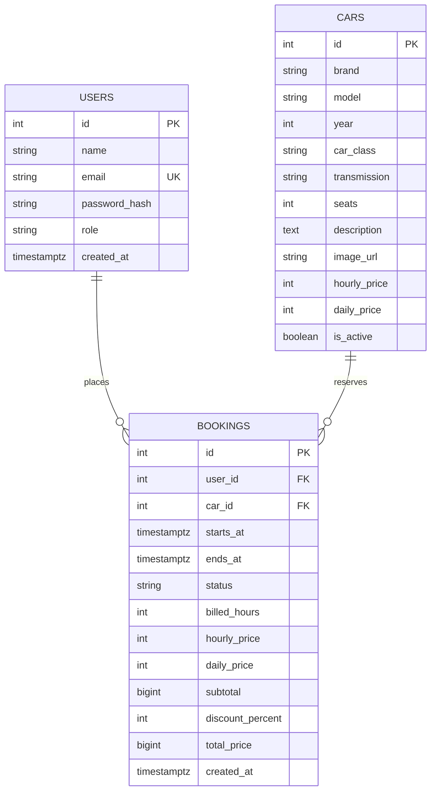

# Architecture and rental rules

One synchronous FastAPI application uses SQLAlchemy sessions and PostgreSQL.
Alembic owns the schema; the application never calls `create_all` on startup.

## Pricing

1. Round the exact duration up to whole hours.
2. Charge complete 24-hour blocks at the daily rate.
3. Charge remaining hours at the hourly rate, capped at one daily rate.
4. Apply 10% for an actual duration of at least 7 days, or 20% for at least 30 days.
5. Round once to whole KZT, half up. Integer arithmetic avoids floating-point money errors.

Rounding a duration up to 168 hours does not qualify it for the seven-day discount
unless the actual duration reaches seven days. Long-term rental uses discounted daily
rates; no separate calendar-month pricing exists.

The same pure function powers quotes, booking snapshots, and recommendations. Saved rates
and totals do not change when administrators edit the car. Totals use `bigint` in PostgreSQL.

## Concurrency

The overlap rule is `existing.start < requested.end AND existing.end > requested.start`.
Intervals are half-open. The PostgreSQL `btree_gist` extension enables an exclusion
constraint on `(car_id, tstzrange(starts_at, ends_at, '[)'))` for pending/confirmed rows.

Creation locks the car while reading its active flag and current rates, rechecks availability,
and commits the booking. The database constraint independently rejects conflicting writes,
including writes outside the API. Exclusion violations become HTTP 409; other unexpected
database errors remain errors.

Status changes lock only the booking row before validating the transition. Cancelled,
rejected and completed bookings stay in history. There is no hard-delete endpoint.

## Boundaries

Users authenticate with a 60-minute HS256 JWT; the role is read from PostgreSQL each time.
Passwords use Argon2. Credentials and environment files are never committed.
Photos are URL fields. Payments, document verification, email, GPS, refresh tokens,
background jobs and ML training are outside this MVP.
